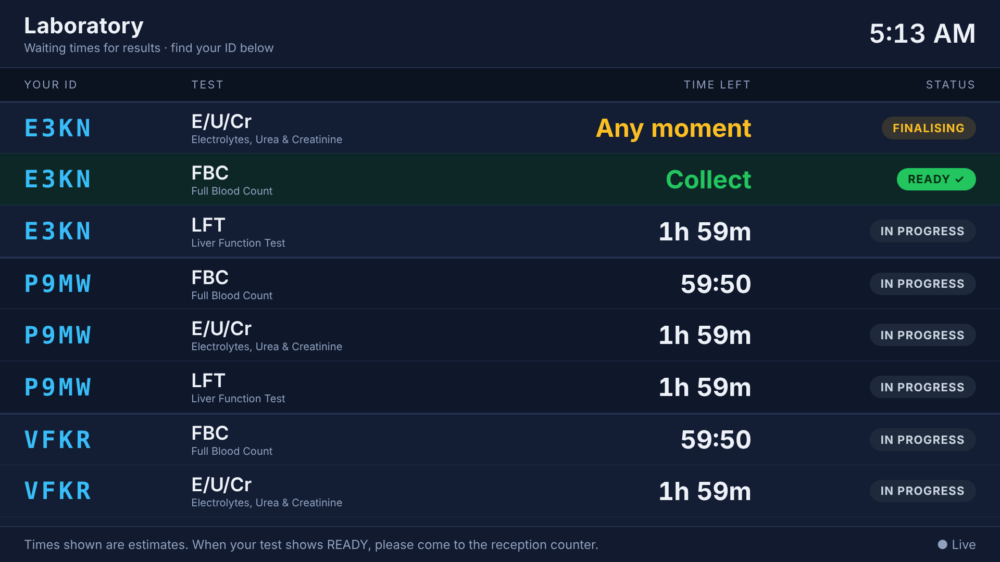
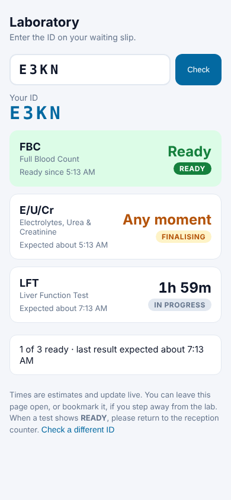
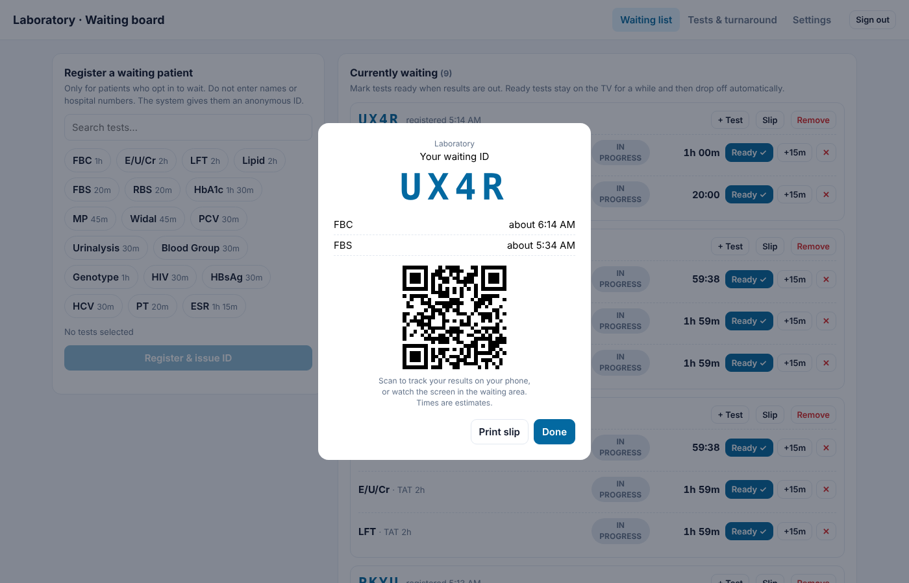

# Lab Waiting Board

An anonymous waiting-time board for the lab reception TV.

When a patient chooses to wait for results, staff register them here. The system gives them a short anonymous ID (for example `E3KN`). No name or hospital number is stored. The TV shows one line for each test: the ID, the test and the time left. The list scrolls, then a QR code screen appears, then the list starts again from the top. Patients can scan the QR code and enter their ID to follow all their tests on their phone, even if they leave the waiting area.

| TV display | Patient phone | Staff: ID slip |
|---|---|---|
|  |  |  |

## Pages

| URL | Who uses it |
|---|---|
| `/display` | The TV. Open it full screen (F11) in a browser. |
| `/staff` | Lab staff, behind a PIN: register patients, mark tests ready, edit turnaround times and settings. |
| `/t` or `/t/<ID>` | Patients, from the QR code. |

## How it works

- **Registration:** staff pick the tests. Each test gets a countdown based on its default turnaround time (TAT), which is set in *Tests & turnaround*. The TATs included are placeholders, so the lab should set its own.
- **Statuses:** *In progress* (counting down), then *Finalising* (time is up but the test isn't marked ready yet; the screen never shows negative times), then *Ready ✓* (staff marked it; the patient should come to the counter).
- **Staff actions:** Ready ✓, +15 min (for a delay), add or remove a test, remove the patient, and reprint the slip.
- **Automatic cleanup:** ready tests leave the TV after 30 minutes. Every entry is deleted 12 hours after registration. Both times can be changed in Settings.
- **Live updates:** the TV and phones update immediately when staff make a change (Server-Sent Events, with polling as a backup).

## Run

```bash
npm install
STAFF_PIN=your-pin npm start   # http://localhost:3000
```

Environment variables:

- `STAFF_PIN`: staff login PIN. **Set this.** The default is 1234.
- `PORT`: default 3000.
- `DATA_DIR`: where `data.json` is kept. Default `./data`.
- `SESSION_SECRET`: optional.

Docker: `docker build -t lab-board . && docker run -p 3000:3000 -e STAFF_PIN=xxxx -v labdata:/data lab-board`

For the QR code to work on patients' phones, the app must be reachable at a public address. If the TV loads it from a local address, set *Settings → Public web address*.
