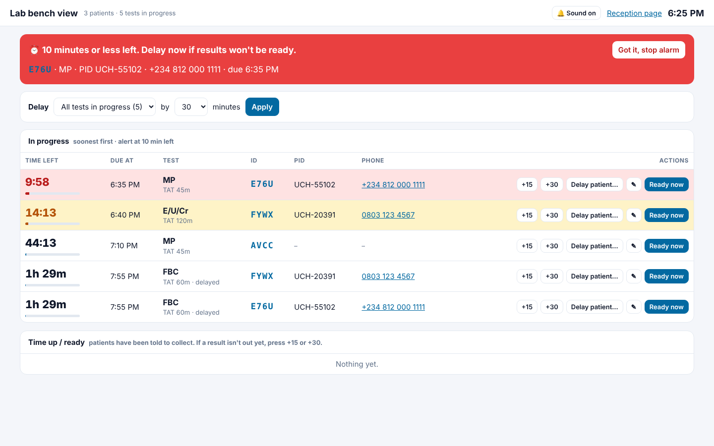

# Lab Waiting Board

An anonymous waiting-time board for the lab reception TV.

When a patient chooses to wait for results, staff register them here. The system gives them a short anonymous ID (for example `E3KN`). Staff can also record the patient's PID and phone number. These are shown only on the staff and lab pages, never on the TV or the patient's page, and are deleted with the entry. The TV shows one line for each test: the ID, the test and the time left. The list scrolls, then a QR code screen appears, then the list starts again from the top. Patients can scan the QR code and enter their ID to follow all their tests on their phone, even if they leave the waiting area.

| TV display | Patient phone | Staff: ID slip |
|---|---|---|
|  |  |  |

## Pages

| URL | Who uses it |
|---|---|
| `/display` | The TV. Open it full screen (F11) in a browser. |
| `/staff` | Reception, behind a PIN: register patients (tests, PID, phone), edit turnaround times, settings and stats. |
| `/lab` | Lab scientists, behind the same PIN: tests sorted by time left, an alarm before time is up, and delays. |
| `/t` or `/t/<ID>` | Patients, from the QR code. |

## How it works

- **Registration:** staff pick the tests. Each test gets a countdown based on its default turnaround time (TAT), which is set in *Tests & turnaround*. The TATs included are placeholders, so the lab should set its own.
- **The system works off the turnaround time:** each test counts down and turns **Ready ✓** by itself when its time is up. When a test becomes ready, the TV shows a big green "Results ready" banner with the ID and test, plays a chime, and the row flashes for 2 minutes. A patient's phone page also chimes and vibrates if it is open.
- **Staff corrections:** **+15m** when a result is delayed, **Ready now** when it's out early, add or remove a test, remove the patient, and reprint the slip.
- **Lab bench view (`/lab`):** tests in progress, soonest due first, with PID and phone. When a test has **10 minutes left** (configurable), the page beeps for ~10 seconds, shows a red banner and sends a desktop notification. This works even when the tab is in the background. Click **Turn on alerts** once after opening the page. Staff can delay one test (+15/+30), one patient, **every test of one type** (e.g. all FBC +30), or **all tests in progress**.

  
- **Daily stats:** patients who waited, tests per day, the average actual wait compared with the set turnaround time, and the number of delayed/early tests. Only counts are stored, never patient data.
- **Automatic cleanup:** ready tests leave the TV after 30 minutes. Every entry is deleted 12 hours after registration. Both times can be changed in Settings.
- **Updates:** countdowns run on each screen. Screens check for staff changes every 10–15 seconds.
- **Sound on the TV:** browsers only allow sound after one key press or click on the page. A TV remote's OK button works. For a kiosk PC, start Chrome with `--autoplay-policy=no-user-gesture-required --kiosk https://…/display`.

## Deploy on Vercel

1. Import this repo into Vercel. No framework or build settings are needed.
2. **Storage → Create / Connect → Upstash for Redis** (the free plan is enough) and connect it to the project. This sets `KV_REST_API_URL` and `KV_REST_API_TOKEN`.
3. **Settings → Environment Variables:** add `STAFF_PIN`, and optionally `SESSION_SECRET` (a long random string).
4. Redeploy. Open `/display` on the TV and `/staff` at reception.

## Run locally

```bash
npm install
STAFF_PIN=your-pin npm start   # http://localhost:3000
```

Environment variables:

- `STAFF_PIN`: staff login PIN. **Set this.** The default is 1234.
- `PORT`: default 3000.
- `DATA_DIR`: where `data.json` is kept when Redis isn't configured. Default `./data`.
- `KV_REST_API_URL` / `KV_REST_API_TOKEN` (or `UPSTASH_REDIS_REST_URL` / `UPSTASH_REDIS_REST_TOKEN`): Upstash Redis. Required on Vercel.
- `LAB_TIMEZONE`: default timezone for daily stats. Default `Africa/Lagos`. Can be changed in Settings.
- `SESSION_SECRET`: optional.

Docker: `docker build -t lab-board . && docker run -p 3000:3000 -e STAFF_PIN=xxxx -v labdata:/data lab-board`

For the QR code to work on patients' phones, the app must be reachable at a public address. If the TV loads it from a local address, set *Settings → Public web address*.
